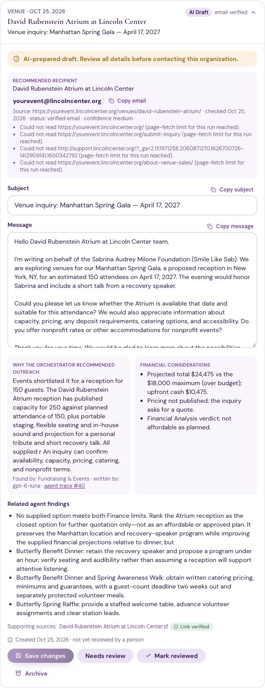
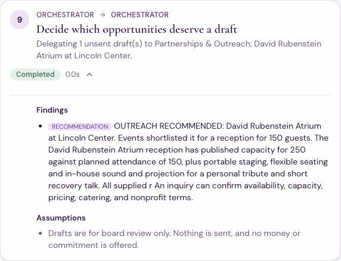
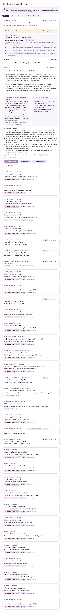
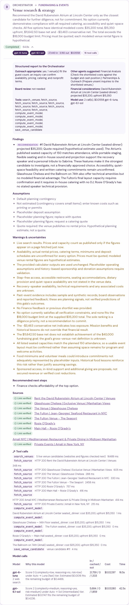

# The Boss Agent and proactive outreach drafts

The Orchestrator acts as SAM SPACE's **AI Chief of Staff**. It delegates work to the specialists, reads their structured reports, and decides what happens next. When a specialist finds a promising venue, charity, research initiative, or sponsor, the Orchestrator now **prepares an unsent outreach draft automatically**, so a board member no longer has to ask for each email.

> **Nothing is ever sent, and no money is ever committed.**
> - Drafts stay in SAM SPACE (Partnerships & Outreach → *Drafts for Board Review*).
> - A board member reviews a draft, copies it, and sends it themselves outside SAM SPACE.
> - An AI draft is not evidence that outreach happened.

> **Evidence:**
> - Every number here comes from logged runs, exported to `docs/evidence/boss_outreach/`.
> - All three workflows ran live with real models and live web research (§9): A is run #40, B is run #43, C is run #44.
> - A and B produced the intended drafts.
> - C (sponsorship) **did not find a business sponsor** in two live searches.
>   - Run #44 drafted introductions to other charities' galas instead. That exposed a gap in the decision rule, which is now fixed.
>   - Rerun #45, after the fix, skipped every non-sponsor and drafted nothing.
> - Earlier attempts at B and C (runs #41, #42) were stopped by the $5 daily AI budget. The chair raised the limit to $10 for runs #43–#45, setting it back to $5 after each session.



## 1. The Boss Agent's ten responsibilities

Each responsibility below is checked against an executed workflow, not just the code.

| # | Responsibility | How SAM SPACE does it | Where to see it |
|---|---|---|---|
| 1 | Receive requests from board members | The `intake` step reads the request. If the board member picked the workflow, no model is needed; otherwise a model classifies it. | Run #40, step 1 |
| 2 | Identify which specialists are needed | The intent picks the workflow: `plan_event`, `mission_discovery`, `partnership_outreach`, and others. | Run #40 route |
| 3 | Delegate clear tasks | `Orchestrator.dispatch()` is the only place a handoff happens. Each handoff carries an objective, inputs, and constraints. | Agent Activity → run → each step |
| 4 | Receive structured reports | Every specialist step stores an **AgentReport** (§2) on its handoff row. | "Structured report to the Orchestrator" box on each step |
| 5 | Coordinate information sharing | Finance's conflicts become structured feedback for Events. History lessons are passed to Events. Reports feed the decision step, and its provenance travels to Outreach. | Run #40: `venues_revision_1` used Finance's feedback |
| 6 | Spot work that needs more research or financial review | Reports name other agents that should contribute. Finance is called for charitable or research opportunities only when the board role allows financial access. | `additional_agents` in each report |
| 7 | Request revisions on conflicts | `evaluate` combines Finance limits, history checks, and verification. It sends one bounded revision to Events. | Run #40: `evaluate` → `venues_revision_1` → `finance_revision_1` |
| 8 | Start outreach-draft preparation | The new **`outreach_decision`** step (§3) selects opportunities and delegates drafts to Partnerships & Outreach. | Run #40, step 9 |
| 9 | Consolidate into a board-ready recommendation | The `recommendation` step (Sol) receives every result, including the drafts. | Run #40 packet |
| 10 | Present all actions for human review | Drafts open as *AI Draft*; the packet lists them as unsent. Nothing is approved automatically. | Review Center |

The Orchestrator has no tool that sends a message, books, pays, or commits anything (§7).

## 2. How specialists report to the Boss: the AgentReport

Code builds each report (`backend/app/agents/reports.py`) from the specialist's validated result and the run's own logs. Because it is assembled in code, it is never a free-form paragraph and never missing a field.

| Field | Contents |
|---|---|
| `task_id`, `workflow_id`, `step_key`, `agent` | Handoff ID, run ID, step, agent name |
| `objective`, `status`, `work_completed` | The assigned task and its outcome |
| `key_findings`, `sources` | Claims with their kind and confidence, and source links with verification status |
| `assumptions`, `risks_uncertainties` | Assumptions and warnings, from the specialist's result |
| `financial_considerations` | Projected totals, upfront cash, the affordability verdict, conflicts, available planning budget |
| `recommended_next_actions` | The specialist's recommendations and next steps |
| `outreach` | `appropriate`, a reason, and candidate names |
| `additional_agents` | Which other agents should contribute, and why |
| `approval` | Whether board review or professional review (accountant/attorney) is needed, and why |
| `tool_calls`, `model_usage` | Every tool call on that handoff; tokens and cost |

**Agent-specific rules:**
- **Events:** outreach is appropriate when it shortlists a venue that fits the guest count. It suggests Finance (to check costs) and Outreach (to draft inquiries).
- **Mission Discovery:** outreach is appropriate only for findings rated *Strong fit* or *Possible fit* **and** backed by a verified (or labeled synthetic) source.
- **Finance:** it never names outreach targets. It reports the verdict, totals, conflicts, and the planning budget, and always says *"not approval to spend"*.
- **A step that did not finish** (stopped by a budget, failed) reports *"The task did not finish …, so it cannot support an outreach decision."* It never presents a stopped search as an empty result.

Specialists only recommend. They never direct each other; the Orchestrator decides.

## 3. The decision step: which opportunities deserve a draft

`outreach_decision` is an Orchestrator step that runs in code, without a model. It reads the reports and builds one candidate per opportunity, each with:
- the agent that found it
- the reason it is worth an inquiry (whole sentences)
- related findings
- financial considerations

**Rules:**
- **Venues** (Workflow A) are eligible when Events reported outreach as appropriate. Their financial considerations show the projected total against the board's maximum, whether pricing is published, and Finance's verdict.
- **Charities, research initiatives, and sponsors** (Workflows B, C) are eligible when rated *Strong fit* or *Possible fit* with a verified or synthetic source. Anything else is skipped with its rating and source status.
- **It must be what the board asked for.** When the request asks only for sponsors (Mission Discovery's plan lists `sponsor` as the only opportunity type), only sponsor findings qualify. Anything else is skipped with, for example, *"not a sponsor (listed as an event); the board asked for sponsors"*. Added after run #44 (§9).
- **Past events are skipped.** If every date in a finding's dates is before today, the decision records *"its date (May 11, 2026) has already passed"*. Recurring schedules ("every Monday") have no date and are not affected. Added after run #44.
- **Sponsors** carry the note *"Any sponsorship would be prospective income: it is never counted until confirmed in writing."*
- **Charities and research initiatives:**
  - Finance states only the available planning budget, never a support amount. It is consulted only if the board member's role has financial access.
  - Otherwise the draft records *"Finance was not consulted: your board role has no financial access. No support amount is proposed."*
- **At most 3 drafts per run.** Further eligible candidates are skipped with the reason "limit of 3 drafts per run".

Each choice is logged as a finding: **OUTREACH RECOMMENDED: …** or **NO DRAFT: …**. The step's data (selected, skipped, provenance) travels to Outreach and then onto each draft.



> **A known issue visible above:**
> - Run #40 was recorded before a fix to how reasons are shortened, so its stored reason is cut mid-word ("All supplied r").
> - Reasons and related findings are now shortened at sentence boundaries (`_clip_sentences`), covered by `test_reasons_end_on_whole_sentences`.
> - The stored run was left as it ran.

**A design choice the board should know about:** in run #40, the Atrium's projected total ($24,475) is over the $18,000 maximum, and Finance's verdict is "not affordable as planned".
- The Orchestrator still prepared an inquiry, because the venue publishes no price. The modeled rental figure is a placeholder, and only an inquiry can get a real quote.
- The draft shows the over-budget finding prominently, and asks questions only. It makes no booking or commitment.

## 4. Contact research: official sources only, never invented

Before writing, Partnerships & Outreach calls `lookup_inquiry_details` for each selected organization (`backend/app/services/contacts.py`).

**Order of preference (from the board's rules):**
1. the official website
2. the official contact page
3. a public general-inquiry address
4. a listed partnership or development contact
5. the official contact form

**Rules enforced in code:**
- **Same site only:** an email counts only if it literally appears on a page of the organization's own website (same domain). Links to other sites are never followed.
- **Never guessed:**
  - no email patterns, no employee names, no phone numbers
  - `noreply@`, `privacy@`, `press@`, and similar addresses are skipped
- **robots.txt is respected.** A disallowed page is not fetched, and the note says so.
- **Its own page allowance:** contact research reads at most **2 pages per draft** (board-adjustable, hard cap 3), and at most 3 drafts' worth per run.
  - This allowance is separate from the research page-fetch limit, so venue or mission research can no longer use it up, as it did in runs #40 and #43.
  - When the allowance runs out, the search stops with one note.
- **Same safe fetcher as all research:** SSRF guard, and size and time limits.
- **No private details:** links carrying private details are refused, and tracking parameters (`?_ga=…`) are not followed.
- **No email found:** the draft displays ***"Contact email not verified — use official contact page."*** and links the official page.

**Each draft's contact record holds:**
- organization
- department (only if the address itself names one, such as `events@`)
- email (if verified)
- contact-page URL
- source URL
- verification date
- status: `verified_email`, `contact_page_only`, `website_only`, or `not_found`; synthetic fixtures are labeled `synthetic_*`
- confidence

**Run #40:** the Lincoln Center events address was found on the Atrium's own venue page.
- Contact status: verified email, confidence medium.
- Source: `https://yourevent.lincolncenter.org/venues/david-rubenstein-atrium/`, checked 2026-10-25 22:38 UTC.
- Events had used most of the run's page fetches, so the other contact pages were not checked. The draft says so.

**A second safeguard in code:** after the model writes a draft, `contact_violations()` scans it.
- An email that is not the verified address, or any phone number, rejects the draft.
- After one bounded rewrite, a still-failing draft is not saved.
- Test: `test_a_draft_cannot_contain_an_invented_email_or_phone`.

## 5. What each draft contains

Partnerships & Outreach (Luna) writes each draft with type-specific rules:

| Type | Must include | Must never |
|---|---|---|
| Venue inquiry | Venue name, a personalized subject, an introduction to the foundation, the event concept, estimated attendance, questions on availability, capacity, pricing, catering, and nonprofit accommodations, a professional closing | Book, hold a date, or accept terms |
| Charity introduction | The organization, the relevant program, why it aligns with the mission, questions about collaboration or support, a polite request for information | Promise or imply a donation |
| Research inquiry | The initiative, why it matters to the foundation, questions about charitable support or collaboration | Invent a relationship with a researcher or institution |
| Sponsorship inquiry | The sponsorship opportunity, the foundation's mission, possible benefits framed as proposals, an invitation to discuss | Guarantee exposure, attendance, or results |

## 6. The Outreach Review Center ("Drafts for Board Review")

Location: Partnerships & Outreach (`frontend/src/components/reviewcenter.tsx`).

**Filters:** All open, AI Draft, Needs Review, Reviewed, Archived.

**Every draft shows:**
- organization and category
- the notice ***"AI-prepared draft. Review all details before contacting this organization."***
- the recommended recipient, with its verified email or the not-verified notice, its source, date, status, and confidence
- the subject and an editable body
- **why the Orchestrator recommended outreach**, and **which agent found it**
- **which model wrote it**, with a link to the agent trace
- financial considerations, related agent findings, and supporting source links (with verification badges)
- created, edited, and reviewed dates, and who edited or reviewed it

**Actions:**
- copy email, copy subject, copy message
- save changes
- mark *Needs Review*
- *Mark reviewed* (disabled while there are unsaved edits)
- archive and restore

**Never:**
- There is no send, "send all", schedule, or contact button.
- Drafts start as *AI Draft* and are never approved automatically.
- The status labels are internal only. Changing a status never triggers anything else.

Every edit and status change is written to the audit log with the changed fields.



## 7. Absolute restrictions, and how they are enforced

**No outreach:**
- No email-sending API or callable sending tool exists.
- Outreach's allow-list is exactly `read_saved_findings`, `lookup_inquiry_details`, `create_outreach_draft`.
- `PROHIBITED_ACTIONS` (23 names) refuses send, reply, forward, DM, form-submission, and scheduling tools even if one were registered: `reply_email`, `forward_message`, `submit_contact_form`, `schedule_outbound_communication`, and others.
- `lookup_inquiry_details` only reads public pages. It never submits a form.

**No financial commitments:**
- The prohibited list also covers `transfer_funds`, `allocate_funds`, `sign_contract`, payment, purchase, and booking names.
- Finance analyzes and recommends only.
- Test: marking a draft *Reviewed* leaves the donations ledger count unchanged.

Tests: `test_no_sending_and_no_spending_capability_exists`, plus the Prompt 7 adversarial suite.

## 8. Traceability

| Question | Where it is stored | Where it is shown |
|---|---|---|
| Which agent found the opportunity? | `outreach_drafts.found_by_agent` | Draft card ("Found by") |
| Why did the Orchestrator recommend outreach? | `recommendation_reason`, and the `outreach_decision` step's findings | Draft card; run trace |
| What research supports it? | `related_findings`, `sources` | Draft card |
| Where did the contact come from? | `contact` (source URL, date, status, confidence, notes) | Draft card contact block |
| Which model wrote it? | `model_used`, taken from the logged model call on that handoff | Draft card ("written by") |
| Are financial assumptions involved? | `financial_considerations` | Draft card |
| Did a human review it? | `status`, `reviewed_by`, `reviewed_at`, `edited_by`, `edited_at`, plus the audit log | Draft card footer |

Each draft also links to its run and handoff (`handoff_id`). Agent Activity shows the structured report on every specialist step:



## 9. The three workflows

### Workflow A: event venue (live, run #40, completed, $0.2112, 8 model calls)

Request: *"Plan a 150-person Manhattan fundraising gala and check whether we can afford it."* Live web research.

| Step | Agent | Model | Cost |
|---|---|---|---|
| intake | Orchestrator | (code) | — |
| lessons | Event Intelligence | gpt-6.1-sol | $0.0534 |
| venues | Fundraising & Events | gpt-6-luna (web search), gpt-6.1-sol | $0.0558 |
| finance | Financial Analysis | gpt-6.1-sol | $0.0123 |
| evaluate | Orchestrator | (code) | — |
| venues_revision_1 | Fundraising & Events | gpt-6.1-sol | $0.0376 |
| finance_revision_1 | Financial Analysis | gpt-6.1-sol | $0.0124 |
| evaluate_revision_1 | Orchestrator | (code) | — |
| **outreach_decision** | Orchestrator | (code) | — |
| **outreach** | Partnerships & Outreach | **gpt-6-luna** | **$0.0004** |
| recommendation | Orchestrator | gpt-6.1-sol | $0.0394 |
| verification | Orchestrator | (code) | — |

**Result:**
- The Orchestrator selected the David Rubenstein Atrium at Lincoln Center and wrote draft #56 (venue inquiry, *AI Draft*).
- The contact is a verified public email, taken from the venue's own page.
- The draft's financial considerations say the projected total is over the board's maximum.
- Nothing was sent.

Files:
- `docs/evidence/boss_outreach/A_venue_live_run_40.json`
- `trace_run_40.json`: every handoff with its structured report, every tool call, every model call

### Workflow B: charitable organization (live, run #43, completed, $0.0953, 5 model calls)

Request: *"Research eating disorder and mental health organizations in New York that the foundation could learn about supporting."* Live web research.

Steps:
1. **intake**: Orchestrator
2. **research**: Mission Discovery. Luna planned the search and ran the web search; Sol compared the sources.
3. **finance**: Financial Analysis, in code. The chair has financial access, so Finance stated the available planning budget and proposed no amount.
4. **outreach_decision**: Orchestrator
5. **outreach**: Partnerships & Outreach, gpt-6.1-sol, $0.0191 for three drafts
6. **recommendation**: Orchestrator
7. **verification**: Orchestrator

**Mission Discovery's report:** six opportunities were well aligned and sourced. The Orchestrator selected three and skipped three with the reason "limit of 3 drafts per run": the New York LGBTQ+ Pro-Recovery Support Group, NEDA, and the IAEDP New York chapter.

| Draft | Organization | Rating | Contact found |
|---|---|---|---|
| #57 | Western New York Comprehensive Care Center for Eating Disorders | Possible fit | Official contact page `nyeatingdisorders.org/contact-us`; no email published, so *"Contact email not verified"* |
| #58 | Columbia Center for Eating Disorders | Strong fit | Official website only. The run's page-fetch limit was reached after one page. |
| #59 | NewYork-Presbyterian Center for Eating Disorders | Strong fit | None. The page-fetch limit was already used up by research, so no contact page was read. |

**Drafts:**
- Every draft asks about programs, impact, and whether foundation support is accepted.
- Each states it is "not a funding commitment". None promises money.
- Each carries Finance's note: *"Available unrestricted planning budget above the reserve floor: $9,938. A starting point for board discussion, not approval to give or spend"* and *"SAM SPACE proposes no support amount."*
- No email was invented for any of the three.

### Workflow C: sponsorship (live, run #44, completed, $0.0742, 5 model calls), but no sponsor found

Request: *"Find possible local business sponsors in Manhattan for our spring gala."* Live web research.

**What happened:**
- Mission Discovery's plan asked for sponsors (`opportunity_types: ["sponsor"]`).
- The live search returned three **other charities' galas**: WithAll's Keys in Bloom Gala, the NEDA Gala 2026, and the Project Blackbird Gala (in Washington, D.C.).
- Its own summary said the sources *"do not verify any Manhattan business as a prospective sponsor"*.

**What the Orchestrator did:**
- All three were rated *Possible fit* with checked sources, so they met the decision rule.
- It drafted three **partner introductions** (drafts #60–#62), not sponsorship inquiries.
- It skipped the fourth result, "NEDA Annual Gala" (Needs research, unverified source).

**Contacts:**
- #60: `hello@withall.org`, found on withall.org's own event page (verified).
- #62: `partnerships@projectblackbirdinc.org`, found on its gala page (verified).
- #61: NEDA's gala page is on a ticketing site whose robots.txt asks automated tools not to read it. It was not read, and only the page link is shown.

**The drafts ask for information only.** For example, #62 notes the gala is outside the Manhattan search area and asks only about programs and collaboration. They are on-mission but **off-request**: the board asked for business sponsors.

**Problems this run exposed:**
- **Off-request drafts:** the decision rule did not check that a finding matched what the board asked for. Now fixed (§3).
- **Past event:** the NEDA Gala 2026 date had already passed, according to Mission Discovery's own warning, yet it was still drafted. Now skipped (§3).
- **Contact research was starved:** research had used the run's page fetches. Contact research now has its own allowance (§4).
- **Garbled cost note:** draft #61's financial note was split into single letters ("T; h; e; …"). A published-cost string had been treated as a list.
  - Fixed after the run, covered by `test_published_costs_and_fit_reasons_stay_readable`.
  - The stored draft was left as it was created.

### Workflow C rerun after the fixes (live, run #45, completed with warnings, $0.0886, 5 model calls)

Same request, run on 2026-10-25 after the sponsor-request and past-event fixes. The chair raised the daily limit to $10 for this run and set it back to $5 right after.

**Research:** the live search again found **no business that sponsors**. It returned:
- a charity's corporate-giving page (NAMI-NYC)
- two galas: Project Healthy Minds (October 8, 2026) and the NEDA gala (May 11, 2026), both already past
- the Manhattan Chamber of Commerce's event-sponsorship page
- two unverified sources

**Decision (the fix working):** the Orchestrator skipped all six, and recorded why for each:
- four with *"not a sponsor (listed as an organization/event); the board asked for sponsors"*
- two with *"Needs research, source unverified"*

**Result:** no draft was written, so nothing off-request reached the Review Center.

**Recommendation (Luna):** *"Use verified Manhattan business networks for sponsor research; no sponsor is confirmed."*

**Why "with warnings":**
- The verification step flagged an availability claim ("are available") that no source confirms.
- One bounded fix ran, and the claim still did not pass, so the run carries the warning to the board instead of hiding it.

**Conclusion:**
- Workflow C behaves correctly: it does not draft to the wrong kind of organization.
- But two live searches (#44, #45) found no business sponsor. Mission Discovery's search looks for mission-aligned opportunities, and sponsor queries surface charities' sponsorship pages rather than businesses.
- A dedicated sponsor-prospecting search would be a new feature (see [limitations.md](limitations.md)).
- The sponsorship-draft path itself (category `sponsor` → `corporate_sponsorship` draft with the prospective-income note) is verified by `test_sponsor_discovery_triggers_a_sponsorship_draft`, not by a live run.

Files: `docs/evidence/boss_outreach/C_sponsor_live_run_45.json`, `trace_run_45.json`.

### Earlier stopped attempts (runs #41, #42)

- Both were stopped by the $5.00 daily cap during research, after $0.0118 and $0.00008. No decision step ran and no draft was created, which is the correct behavior.
- Their exported reports were generated before the stopped-task fix in §2, so they still read "No opportunity is both well aligned and verified". A stopped step now reports that it did not finish.

## 10. Model routing and cost

| Task | Model | Why |
|---|---|---|
| Contact research | **No model** | Contact details come from code reading the official page, so there is nothing for a model to invent. |
| Venue inquiry drafts | gpt-6-luna | A basic draft from structured inputs ($0.0004 in run #40) |
| Charity, research, and partner introductions | gpt-6.1-sol | The router scores "personalized partnership drafts from research" as medium complexity and medium risk. They explain mission alignment to health organizations without promising money. Cost: $0.019–$0.020 for three drafts (runs #43, #44). Moving them to Luna would be a cost cut to A/B test. |
| Venue research categorization | gpt-6-luna with web search | Simple retrieval |
| Venue strategy, lessons, Finance narrative, cross-department recommendation | gpt-6.1-sol | Conflicting financial and mission considerations |

All limits from Prompt 7 still apply:
- the Portkey key is Luna-only
- the per-run budget, with worst-case reservation, and the daily cap
- handoff, revision, and loop limits
- structured-output validation, source verification, and untrusted-text screening

`test_routing_and_spending_limits_apply_to_outreach` checks:
- venue inquiry drafts use Luna
- a $0.01 workflow budget stops the run before any draft
- the Portkey path keeps every agent on Luna

## 11. Automated tests

File: `tests/test_boss_outreach.py`, 16 tests, deterministic fixtures and a scripted model, all passing.

| # | Required test | Test(s) |
|---|---|---|
| 1 | Orchestrator task delegation | `test_venue_workflow_delegates_reports_and_drafts_automatically` |
| 2 | Structured agent reporting | `test_every_specialist_returns_a_structured_report` |
| 3 | Cross-agent information sharing | `test_venue_workflow_…` (lessons → Events; Finance's verdict → decision → drafts; Outreach depends on the decision) |
| 4 | Venue discovery triggers a draft | `test_venue_workflow_…` |
| 5 | Charity discovery triggers a draft | `test_charity_and_research_discovery_trigger_drafts_without_promising_money` |
| 6 | Sponsorship discovery triggers a draft | `test_sponsor_discovery_triggers_a_sponsorship_draft` (and non-sponsors are skipped), `test_past_events_and_off_request_findings_get_no_draft` |
| 7 | Verified contact appears in drafts | `test_verified_contacts_are_attached_and_missing_ones_are_flagged` |
| 8 | Missing contact produces a warning | same test, plus `test_live_contact_research_only_accepts_addresses_on_the_official_site` and `test_contact_research_has_its_own_page_allowance` |
| 9 | No fabricated emails | `test_a_draft_cannot_contain_an_invented_email_or_phone`, `test_live_contact_research_…` |
| 10 | No email-sending capability | `test_no_sending_and_no_spending_capability_exists` |
| 11 | No spending capability | same test (ledger count unchanged after review) |
| 12 | Human-review status tracking | `test_review_statuses_and_edits_persist` |
| 13 | Edited drafts persist | same test (and workspace isolation) |
| 14 | Correct source attribution | `test_verified_contacts_…` (found-by, reason, model, handoff) |
| 15 | Agent activity logging | `test_tool_calls_and_reports_are_logged_for_the_whole_run` |
| 16 | Spending limits and model routing | `test_routing_and_spending_limits_apply_to_outreach` |

Also: `test_finance_is_consulted_only_with_financial_access`, `test_reasons_end_on_whole_sentences`, and `test_published_costs_and_fit_reasons_stay_readable`.

Run them with:

```bash
python -m pytest tests/test_boss_outreach.py -q
```

## 12. Limitations

- **Request matching is narrow.** Only a sponsors-only request is checked against finding categories. A mixed request (for example "charities and sponsors") accepts any on-mission finding.
- **Past-event detection reads written dates only.** A finding whose dates are vague ("spring 2026") is not recognized as past.
- **Contact research is shallow by design.** It reads at most 3 pages per organization. A site that lists its address only in an image, a script, or a page more than one link deep will show *"Contact email not verified"*.
  - A site that lists its address only in an image, a script, or a page more than one link deep will show *"Contact email not verified"*.
- **Contact pages change.** A draft's contact was correct on its verification date. Re-check it before use (see the roadmap).
- **Over-budget venues still get an inquiry** when pricing is unpublished (§3). The board sees the over-budget finding on the draft. If the board prefers, a future rule could skip them.
- **No human has reviewed a draft yet.** The Reviewed status and edit tracking are tested, but not yet used by a board member.
- **Outlook is not connected.** It is planned only; see [roadmap.md](roadmap.md).
