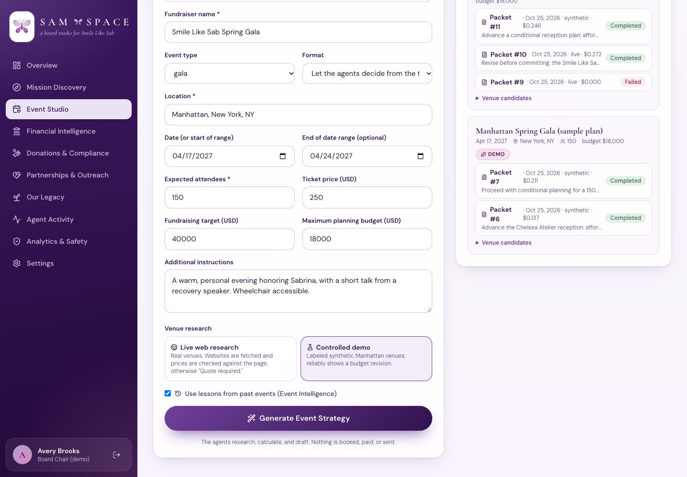
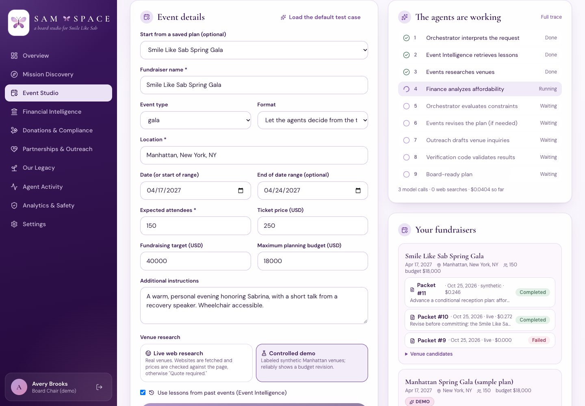
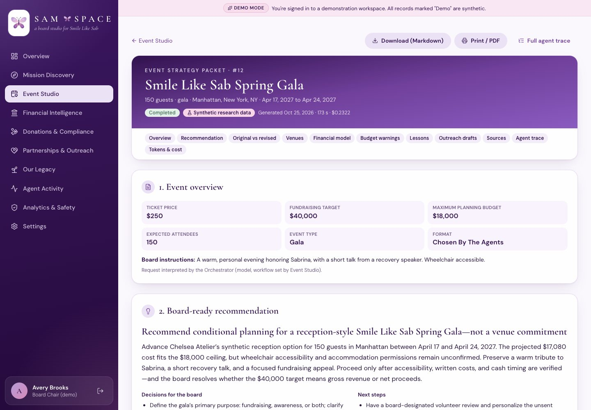
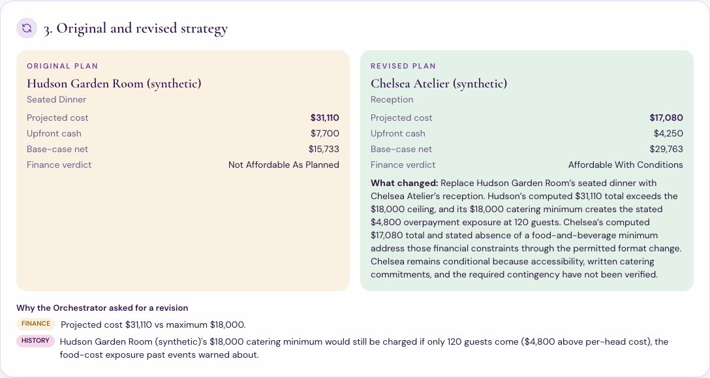
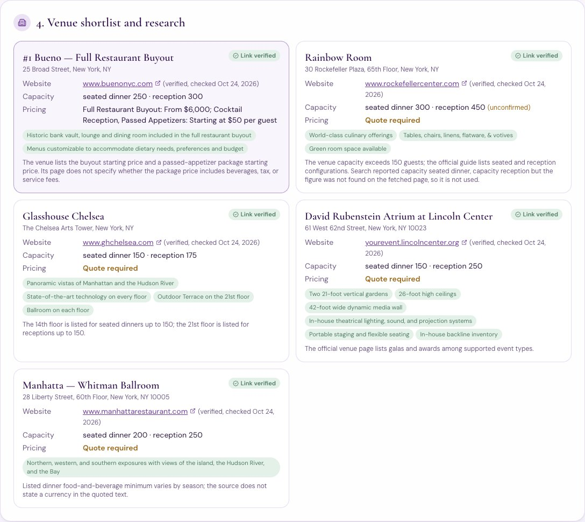
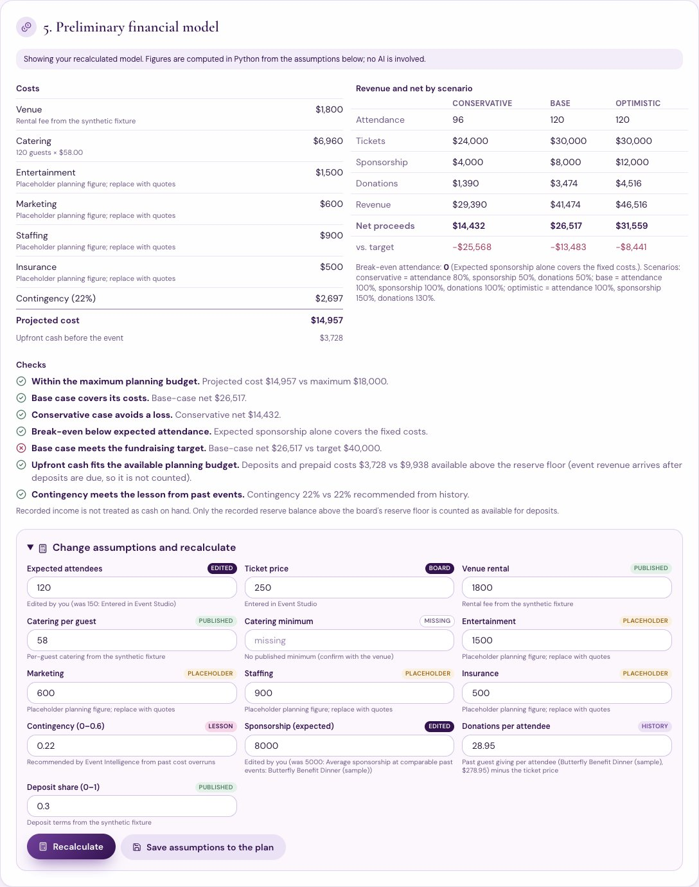
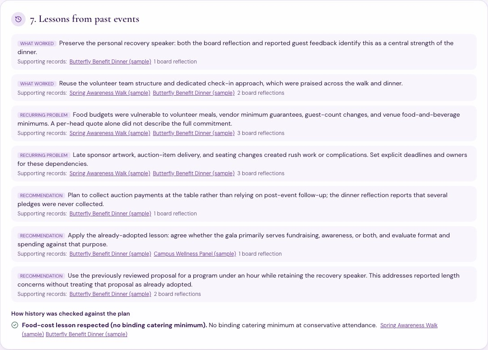

# Event Studio: the flagship workflow

Event Studio turns a board member's fundraiser idea into a board-ready **Event Strategy Packet**. Seven agents coordinate through typed handoffs, and every number is computed in Python.

> All figures here come from real runs against the OpenAI API, stored in the app's run log and exported to `docs/evidence/event_studio/`. The live run used real public web research. The controlled demo used labeled synthetic venues on `example.org`, and is never presented as live research.

## 1. The form

**Inputs:**
- fundraiser name, event type, and optional format
- location
- date or date range
- expected attendees and ticket price
- fundraising target
- maximum planning budget
- additional instructions

**Load the default test case** fills in: *Smile Like Sab Spring Gala, 150 guests, Manhattan, April 17–24, 2027, $250 tickets, $40,000 target, $18,000 maximum budget.*

**Research source** is a choice between **Live web research** and the **Controlled demo**. A checkbox turns Event Intelligence (historical lessons) on or off.

## 2. The nine steps, live

| # | Step | Who | How |
|---|---|---|---|
| 1 | Interpret the request | Orchestrator | gpt-6-luna reads the request and extracts details. The workflow itself is fixed by Event Studio. If the model can't be reached, keyword routing takes over. |
| 2 | Retrieve lessons | Event Intelligence | gpt-6.1-sol, citing event and reflection IDs that code then checks |
| 3 | Research venues | Fundraising & Events | Live: one web search, then each website is fetched, and published figures count only if they appear on the page. Synthetic: labeled fixtures. Every option is priced by the deterministic model, and gpt-6.1-sol ranks the options and writes the strategy. |
| 4 | Analyze affordability | Financial Analysis | Recomputes the model itself and checks it against the ledger. gpt-6.1-sol only explains the result. |
| 5 | Evaluate constraints | Orchestrator (code) | Combines Finance's conflicts with history checks, such as a catering minimum that would still bind at 80% attendance when past reflections flagged food costs |
| 6 | Revise if needed | Events → Finance → Orchestrator | At most 1 revision round (hard cap 2). It reuses the researched venues (no new search), and code re-ranks if the model's choice still breaks a limit. |
| 7 | Draft venue inquiries | Partnerships & Outreach | gpt-6-luna writes unsent, editable drafts asking about pricing, capacity, availability, and nonprofit rates |
| 8 | Validate | Verification code | Every dollar figure must trace to a calculation, and the recommendation may not claim anything was booked or sent. One bounded fix is allowed. |
| 9 | Board-ready plan | Orchestrator | gpt-6-astra writes the recommendation, which code then verifies, and the packet is assembled |

## 3. The Event Strategy Packet

The packet contains the 11 sections the brief asks for:
1. event overview
2. board-ready recommendation
3. original vs. revised strategy, with the reason for each change
4. venue shortlist with research
5. preliminary financial model
6. budget warnings
7. lessons from past events, linked to the historical records
8. unsent, editable outreach drafts
9. supporting sources
10. agent handoff trace
11. token usage and cost

It can be downloaded as Markdown, printed or saved as PDF, and redacted for board members without finance access.

### Original vs. revised (controlled demo, run #12)

The first plan (Hudson Garden Room, seated, **$31,110**) failed two separate tests:
- **Finance:** over the $18,000 maximum.
- **History:** its $18,000 catering minimum would still be charged at 120 guests, $4,800 above per-head cost. That is the food-cost exposure board reflections warned about.

The Orchestrator requested a revision. Events moved to a Chelsea Atelier reception (**$17,080**), and Finance's verdict became *affordable with conditions*. The only remaining warning: base-case net is below the $40,000 target.

### Venue research (live run #10)

**Five real Manhattan venues were found:**
- Rainbow Room
- Glasshouse Chelsea
- David Rubenstein Atrium at Lincoln Center
- Bueno (full buyout)
- Manhatta

Every website was fetched and verified, and each venue shows the date it was checked.

**Capacity** is shown as published only when the number appears on the fetched page. The Rainbow Room's capacities were not on its page, so they are marked *unconfirmed*.

**Pricing** appeared on the page for Bueno only ("Full Restaurant Buyout: From $6,000"). The other four show **Quote required**. The model uses a hypothetical estimate for them, labeled as such.

### The financial model, and recalculating it

**Costs:** venue, catering (with the venue's minimum applied in code), entertainment, marketing, staffing, insurance, and contingency.

**Revenue:** ticket sales, sponsorship, and donations, each in three scenarios:

| Scenario | Attendance | Sponsorship | Donations |
|---|---|---|---|
| Conservative | 80% | 50% | 50% |
| Base | 100% | 100% | 100% |
| Optimistic | 100% | 150% | 130% |

**Other outputs:** net proceeds, gap to target, break-even attendance (found by search, with minimums included), and upfront cash.

**Every assumption is labeled** as published, board, history, lesson, placeholder, hypothetical, or missing. The board can edit any assumption and recalculate instantly, with no AI involved, and save the changes to the plan for the next run.

**Cash is treated conservatively:** recorded income is not treated as cash. Only the reserve above the board's 3-month floor ($9,938 in the demo books) counts toward deposits.

### Lessons from past events

Each lesson links to the past-event records behind it (`/legacy/<id>`). The history check shown is the final evaluation ("Food-cost lesson respected (no binding catering minimum)": passed for Chelsea). The earlier failure for Hudson appears in section 3 as the *history* reason for the revision.

## 4. Measured runs

| Run | Research | Outcome | Model calls | Web searches | Tokens in (cached) / out | Cost | Time |
|---|---|---|---|---|---|---|---|
| #10 | **Live** | Bueno seated $18,700 > $18,000. A revision was requested, but nothing cheaper was found, so the plan goes to the board: "Revise before committing" | 9 | 2 | 44,690 (1,610) / 9,450 | $0.2722 | 153 s |
| #11 | Synthetic | Hudson seated $31,110 (finance + history conflicts) → Chelsea reception $17,080 | 8 | 0 | 21,506 (3,196) / 8,146 | $0.2458 | 138 s |
| #12 | Synthetic (run from the UI) | Same as #11, the controlled demo reproduced | 8 | 0 | 21,141 (6,465) / 8,047 | $0.2322 | 173 s |
| #9 | Live | **Failed**: the machine lost its internet connection (`APIConnectionError`), and the run was recorded as failed | 1 | 0 | 0 / 0 | $0.0000 | 30 s |

Run #9 is kept in the log because it really happened. It led to a fix: interpreting the request now falls back to keyword routing when the model can't be reached (tested).

**Structured logs** are in `docs/evidence/event_studio/`:
- `packet_run_<id>.md` and `.json`: the packet
- `trace_run_<id>.json`: every handoff (with the constraints passed), tool call, and model call, with model choice, reason, tokens, cost, and latency

The logs contain no prompts and no keys.

## 5. The five required test scenarios

All five live in `tests/test_event_studio.py`. They run offline with a scripted model, so results are the same every time.

| Scenario | Test | What it proves |
|---|---|---|
| 1. Affordable event | `test_affordable_event_needs_no_revision` | 100-guest reception, $25,000 budget: no revision steps, verdict *affordable*, total $12,765 computed in code |
| 2. Over-budget event, revised | `test_over_budget_event_is_revised_and_packet_explains_why` | The $18,000 gala revises from an over-budget seated dinner to a reception. The packet shows original vs. revised, the reasons (over budget, upfront cash), unsent drafts for shortlisted venues, and all packet sections. |
| 3. Missing venue pricing | `test_missing_venue_pricing_shows_quote_required_and_hypothetical_estimate` | Gramercy Hall publishes no prices. The packet shows **Quote required**, the venue cost is labeled *hypothetical*, catering is labeled *placeholder*, and a budget warning appears. |
| 4. Incomplete financial information | `test_incomplete_financial_information_is_reported_not_guessed` | With no ticket price and no reserve on record: the verdict is *insufficient data*, net and break-even are left empty (not guessed), the available budget is "Not supported", and missing-input warnings appear. Unknowns never trigger revisions. |
| 5. History-affected event | `test_history_lesson_alone_triggers_a_revision` + `test_same_plan_without_history_keeps_the_original_choice` | Within budget, but the venue's catering minimum contradicts a food-cost lesson, so the revision reason is *history* only. With history turned off, the original venue stays. |

**More tests in the same file:**
- deterministic recalculation, with input limits and member access refused
- saved board assumptions flowing into the next run
- packet redaction for board members
- date-range validation
- live venue honesty with a simulated page fetch: an unlisted rental price is dropped, an unreachable site is shown as not researched, and figure matching uses whole numbers only
- outreach drafts only for shortlisted venues, and always unsent
- packet assembly is deterministic
- the request is still interpreted during a provider outage

**Total suite: 148 tests.**

## 6. Limits

- Live venue sites often hide prices behind inquiry forms, so live budgets rely mainly on labeled hypothetical estimates until quotes arrive. The outreach drafts exist to get those quotes.
- Availability is never known from public pages. Every recommendation treats it as unconfirmed.
- Donations per attendee come from past events. With no comparable event (for example, the first reception), the model falls back to all past events and says so.
- One revision round is the default. When nothing in the research meets the limits (live run #10), the packet says so plainly and leaves the trade-off to the board.
