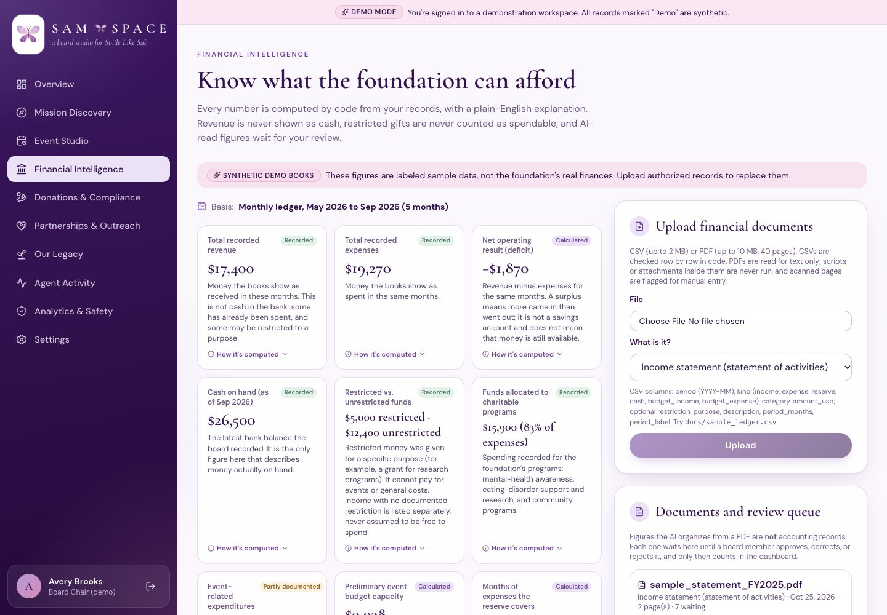
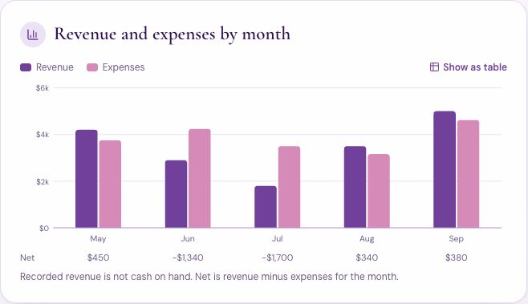
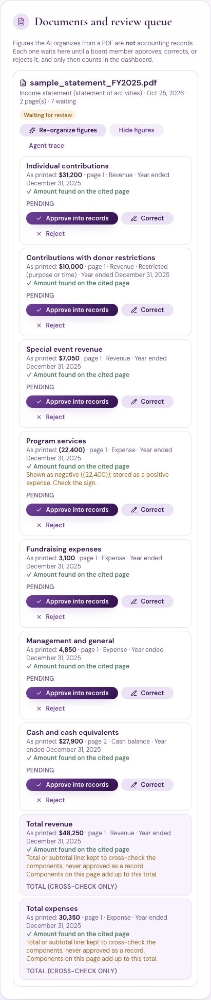
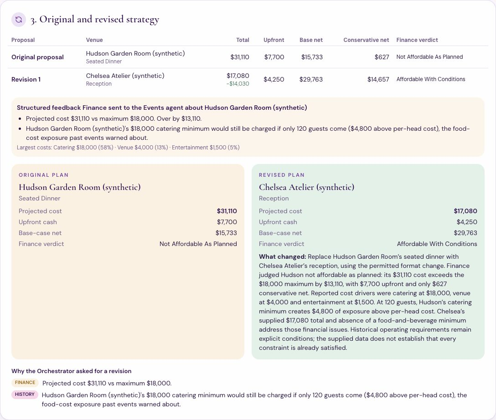
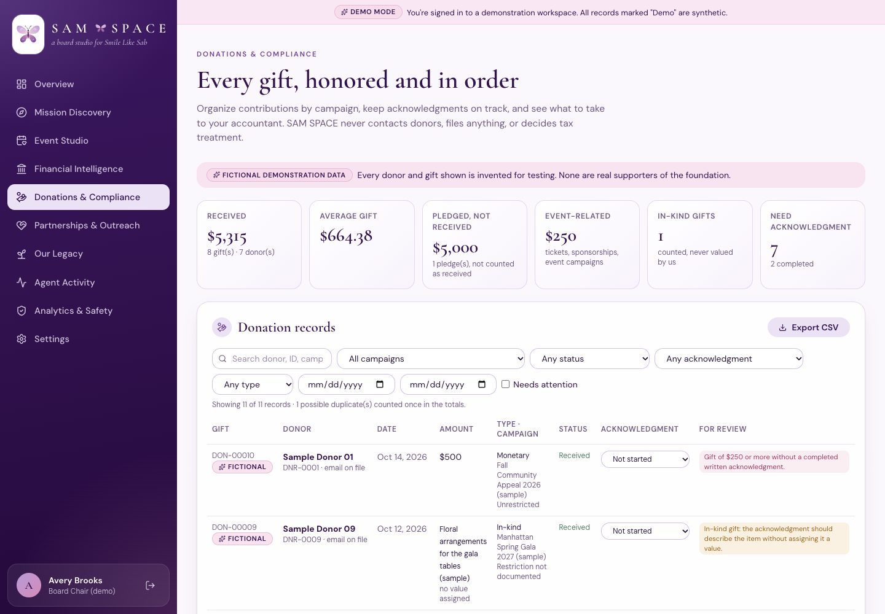
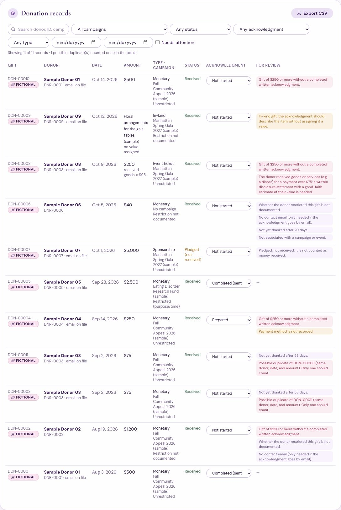
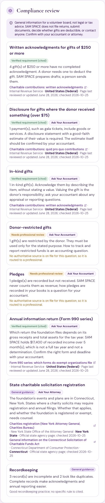

# Financial Intelligence, Donations & Compliance

This phase adds two workspaces:
- **Financial Intelligence** helps the board see what the foundation can responsibly afford.
- **Donations & Compliance** keeps every gift organized, acknowledged, and ready for professional review.

Every number is computed in Python. The models only organize documents, explain computed results, and draft letters.

> **Demo data:** all figures and donors shown are fictional demonstration data (marked "Synthetic", "Sample", or "Fictional"). None are real Sabrina Audrey Milone Foundation records.
>
> **Evidence:** real model runs are listed in §6 and exported to `docs/evidence/finance_donations/`. The automated tests in §7 use a scripted model (mocks) and make no API calls.

## 1. Financial Intelligence dashboard

Each metric has a status: *recorded*, *calculated*, *partly documented*, or *not documented*. Each also has a plain-English explanation and a "How it's computed" note. On the demo books (monthly ledger, May–Sep 2026):

| Metric | Demo value | What it means |
|---|---|---|
| Total recorded revenue | $17,400 | Money the books show as received. **Not cash in the bank.** |
| Total recorded expenses | $19,270 | Money the books show as spent |
| Net operating result | −$1,870 (deficit) | Revenue minus expenses; a surplus would not mean money is still available |
| Cash on hand (Sep 2026) | $26,500 | The only figure that describes money actually on hand |
| Restricted vs. unrestricted | $5,000 restricted · $12,400 unrestricted | Restricted money can't pay for events. Undocumented income is listed separately, never assumed unrestricted. |
| Funds to charitable programs | $15,900 (83% of expenses) | Program spending |
| Event-related expenditures | Not in the ledger · $20,800 across 3 past events | Event costs come from Our Legacy when the ledger doesn't tag them |
| Preliminary event budget capacity | $9,938 | Unrestricted money above a 3-month safety floor. A starting point for discussion, **not approval to spend.** |

**How the capacity is calculated:**
- It uses the **lower** of two figures: the reserve above the floor, or cash minus restricted funds, minus the floor.
- If restricted gifts are on record but no restricted balance is, they are **assumed unspent**.

**Also on the page:**
- revenue and expenses by month
- revenue by source
- spending by purpose
- budget vs. actual (Operations $370 over, Programs $100 under)
- a three-month outlook labeled *estimates, not forecasts*
- a table of past events
- warnings and missing information
- a plain-English glossary: net proceeds, break-even, restricted funds, planning budget, uncertainty

**Chart colors:** plum `#70409B`, rose `#D58AB8`, and blue `#3F72B8`. They pass the dataviz color-vision validator: color-vision deficiency ΔE 13.1 or more, normal-vision ΔE 23.4. Rose has low contrast on white, so every chart has a legend, a hover/focus tooltip, and a "Show as table" view.

## 2. Financial documents: upload, extraction, review

**Accepted files and storage:**
- **Types:** CSV (≤ 2 MB) and PDF (≤ 10 MB, ≤ 40 pages), checked by their contents rather than their extension.
- **Filenames:** sanitized; path traversal and odd characters are stripped.
- **Storage:** private, per organization, under each file's SHA-256 hash.
- **Duplicates:** uploading the same file twice is blocked. Rows that match existing figures need confirmation.

**CSV.** Parsed in code, all-or-nothing:
- Every row is validated, and spreadsheet formulas are neutralized.
- Each record keeps its source file, row, original amount, currency, and status ("parsed from CSV").

**PDF.** Read with `pypdf`, text only:
- **Never executed:** embedded JavaScript, launch actions, and attachments are detected and never run. The document card says so.
- **Unreadable files:** scanned, image-only, or password-protected PDFs are marked *needs manual entry*. They never reach a model.
- **Injected instructions:** removed before the model sees the text.

**Extraction** (Financial Analysis agent, gpt-6-luna). The model copies each figure as printed, with its page. Code then:
- checks that the amount is on that page
- parses it deterministically, flagging negatives
- keeps subtotal and total lines only to cross-check their components
- stages every figure as **pending**

**Review queue.** A board member approves, corrects, or rejects each figure. Only an approved figure becomes a financial record. It keeps its document, page, original amount, period, and "reviewed from a document". Annual statements stay separate from the monthly ledger, so they are never added onto it.

**No repeat charges:** re-organizing an already-extracted document returns 409 unless the board confirms.

**Manual entry and correction:**
- Board members can enter figures directly (with duplicate detection) and correct any record.
- A correction marks a document-based record "corrected by a board member".
- The audit log records field names only, never amounts.

## 3. Event Studio financial planning (Financial Analysis × Events)

**Costs** in the event model:
- venue, catering (with minimums), entertainment, marketing, staffing
- insurance and permits, miscellaneous, contingency

**Revenue:** tickets, sponsorship, donations, and other documented sources.

**Outputs:**
- total cost, revenue, and net proceeds
- break-even attendance
- conservative, base, and optimistic scenarios (one reusable function, `fin_calc.event_scenarios`)
- labeled assumptions that can be edited and recalculated with no AI involved

**Pledged sponsorship is never guaranteed:**
- The conservative scenario counts only sponsorship the board marks as **confirmed** (signed or received).
- A second break-even shows the headcount needed if no unconfirmed sponsorship arrives.

**Price labels:** verified venue prices are labeled *published*; planning figures are labeled *placeholder* or *hypothetical*.

### "Can the foundation afford a 150-person fundraising gala in Manhattan?" (real run #19)

1. **Orchestrator:** gpt-6-luna classified the question as event planning, not a books review.
2. **Event Intelligence:** returned lessons, including food-cost overruns.
3. **Events:** proposed Hudson Garden Room, a seated dinner at **$31,110**.
4. **Financial Analysis:** recomputed the model against the authorized $18,000 budget and the records. **needs revision**.
5. **Orchestrator (code):** evaluated the result. Over budget by $13,110, and the $18,000 catering minimum would still be owed at 120 guests.
6. **Structured feedback to Events:** each issue with its limit and how much the plan was over, plus the cost drivers (Catering $18,000 = 58%, Venue $4,000 = 13%, Entertainment $1,500 = 5%).
7. **Events revised:** Chelsea Atelier reception, **$17,080** (−$14,030). Finance's verdict: *affordable with conditions*.
8. **Orchestrator:** compared the two proposals side by side and saved both.
9. **gpt-6-astra:** wrote the recommendation, including **mission impact considerations**. These are not scored and never override the cost ceiling or restrictions.
10. **Verification:** all 7 checks passed.

If no authorized budget exists, the recommendation says so. It never treats available capacity as authorization.

## 4. Donations & Compliance

**Each donation has:**
- a gift ID (`DON-00008`) and a donor ID (`DNR-0008`)
- date, amount, and currency
- type: monetary, in-kind, event ticket, sponsorship, or matching gift
- campaign or event
- restriction
- payment status: received, pledged, pending, or returned
- acknowledgment status: not started, prepared, completed, or not needed
- notes, source, and created/updated timestamps

**Personal information is kept to a minimum:**
- Donors have only a name and an optional email.
- Emails never leave the server, not even in exports.
- Tax treatment always reads "Not determined by SAM SPACE".

**Totals:**
- Pledges are never counted as received, and in-kind gifts are counted but never valued.
- Possible duplicates count once.
- Donation records are **reconciled** against the ledger, never added to it.

**Board actions:**
- add, edit, import CSV (all-or-nothing, with duplicate checks), export CSV (audited and formula-safe)
- search and filter, associate gifts with campaigns
- set acknowledgment status

### Compliance review, with sources

Each item is labeled one of three ways:
- a **verified requirement**, citing an authoritative page with its jurisdiction and the date it was checked
- **general guidance**, when it depends on facts the app can't verify
- **needs professional review**, when no source covers it

Sources were checked on 2026-10-25 (`backend/app/compliance.py`):
- **IRS, United States (federal):** written acknowledgments for single gifts of $250 or more; quid pro quo disclosure for payments over $75 where the donor received goods or services; Form 990-series thresholds. All three IRS pages were last reviewed June 28, 2026.
- **New York Attorney General Charities Bureau** and **Connecticut Department of Consumer Protection:** charitable solicitation registration. These are general guidance for counsel; the jurisdictions come from where events are held.

The app never gives a tax or legal opinion, never decides deductibility, and never files anything.

### Acknowledgment drafts (Donations & Compliance agent)

There are **two kinds of draft**:
- **General thank-you letter.** gpt-6-luna writes one template with merge fields. Python fills in each donor's verified details on the server, so the model never sees a donor.
  - Templates that claim how a gift was spent, or that mention tax treatment, are rejected. One rewrite is allowed, then nothing is saved.
  - Likely duplicate records get no second letter.
- **Contribution acknowledgment (for accountant review).** Built entirely in code from the record:
  - for $250+ gifts, in-kind gifts, and quid pro quo gifts
  - cites the IRS source and jurisdiction
  - marks every uncertain statement [confirm]

**Drafts stay drafts.** They can be generated, edited, saved, copied, and archived, but there is no send button and no "sent" status (the API returns 422). The agent's tools cannot send, email, or file.

**Records stay untouched.** Drafting never changes a donation record. A board member marks acknowledgments *prepared* or *completed*; "completed" means a person sent it outside SAM SPACE.

**What the review sees.** The review step (gpt-6.1-sol) gets only counts and campaign totals. Each reporting question must cite a known source, or it is routed to an accountant or attorney.

## 5. Privacy and security

**Access:**
- **Finances:** viewing needs `view_financials`; changing needs `manage_financials` (chair and treasurer).
- **Donations:** viewing needs `view_donor_data`; changing needs `manage_donations`.
- **Members** get 403 on all of these.
- **Workspaces are isolated:** another organization's chair gets 404 on this foundation's records. This is tested.

**Logging:**
- Tool-call logs keep only scalar arguments and a redacted summary.
- Audit entries record IDs and field names, never amounts or donor details.
- Exported traces redact donation lists.

**Model inputs:**
- Donor names never reach any model or search query.
- The Events and Outreach agents never receive donor or ledger data.
- The Finance agent gets only aggregates for reviews.

## 6. Real model runs (OpenAI API, official prices)

| Run | Workflow | Models | Tokens in (cached) / out | Cost | Time |
|---|---|---|---|---|---|
| #16 | Organize figures from a sample statement PDF: 9 figures, all found on their page, totals cross-checked | luna | 1,157 / 678 | $0.0005 | 7 s |
| #17 | Financial review. **Exposed a bug:** final verification rejected a correctly quoted "−$1,870" because it compared signed values. Fixed and tested. | sol, luna | 8,338 / 4,009 | $0.0352 | 49 s |
| #18 | Financial review after the fix; all checks passed | sol, luna | 5,705 (2,539) / 2,653 | $0.0112 | 31 s |
| #19 | "Can the foundation afford a 150-person fundraising gala in Manhattan?" (§3) | luna, sol, astra | 28,623 (1,062) / 10,525 | $0.3151 | 174 s |
| #20 | Donations review: sourced reporting questions, 7 thank-you drafts, 4 contribution acknowledgments | sol, luna | 4,467 / 2,120 | $0.0184 | 25 s |
| #21 | Draft for one gift. **Exposed a merge bug:** "your gift of your gift of $250.00". Fixed; that draft was archived. | luna | 1,560 / 824 | $0.0006 | 9 s |
| #22 | Drafts for the gala ticket and the in-kind gift after the fix | luna | 1,584 / 769 | $0.0005 | 8 s |

The Prompt 6 runs cost **$0.38** in total. Under the course Portkey key, both workspaces run on gpt-6-luna only; this is tested.

## 7. Automated tests (mocked model, deterministic)

All 17 required cases are covered; the **full suite has 194 tests**.

| # | Requirement | Where |
|---|---|---|
| 1 | CSV financial upload | `test_finance.py::test_csv_upload_is_parsed_in_code_with_provenance_and_duplicate_checks` |
| 2 | CSV donation import | `test_donations.py::test_donation_csv_import_with_campaigns_and_safe_cells` |
| 3 | Duplicate donation detection | `test_donations.py::test_duplicate_donations_are_detected_and_never_double_counted` |
| 4 | Revenue and expense totals | `test_finance.py::test_dashboard_separates_revenue_cash_and_restricted_funds`, `test_calculations_are_deterministic` |
| 5 | Restricted vs. unrestricted | `test_finance.py::test_restricted_money_is_never_counted_as_spendable` |
| 6 | Event break-even | `test_finance.py::test_calculations_are_deterministic`, `test_event_studio.py::test_affordable_event_needs_no_revision` |
| 7 | Conservative/base/optimistic | `test_donations.py::test_three_scenarios_never_count_pledged_sponsorship_as_guaranteed` |
| 8 | Missing-data warnings | `test_donations.py::test_missing_information_is_stated_not_guessed`, `test_event_studio.py::test_incomplete_financial_information_is_reported_not_guessed` |
| 9 | Finance handoff to the Orchestrator | `test_donations.py::test_affordability_question_drives_finance_feedback_and_a_revision` |
| 10 | Events revision after a budget warning | same test, plus `test_event_studio.py::test_over_budget_event_is_revised_and_packet_explains_why` |
| 11 | Donor acknowledgment drafts | `test_donations.py::test_acknowledgment_drafts_merge_verified_details_and_change_no_records`, `test_templates_claiming_spending_or_tax_treatment_are_rejected` |
| 12 | No automatic donor outreach | `test_donations.py::test_no_automatic_donor_outreach`, `test_mission.py::test_drafts_are_saved_editable_and_never_sent` |
| 13 | Unauthorized access | `test_donations.py::test_members_and_other_workspaces_cannot_reach_donor_or_financial_records`, `test_finance.py::test_members_cannot_see_or_change_financials` |
| 14 | Malformed or unsupported documents | `test_finance.py::test_pdf_scripts_are_never_run_and_scanned_files_need_manual_entry`, `test_figures_not_on_the_page_are_flagged`, CSV cases |
| 15 | Model routing | `test_donations.py::test_donation_review_routing_sources_and_usage_logging`, `test_portkey_keeps_finance_and_donation_work_on_luna`, `test_finance.py::test_pdf_figures_wait_for_board_review_before_counting` |
| 16 | API usage logging | `test_donations.py::test_donation_review_routing_sources_and_usage_logging` |
| 17 | Edited records persist | `test_donations.py::test_edited_donation_and_financial_records_persist` |

## 8. Limits

- **PDF extraction:** it reads the text layer only, so scanned statements need manual entry (no OCR). Complex multi-column statements may be read out of order; the page check and the totals cross-check exist to catch that.
- **Compliance sources:** these are summaries of authoritative pages checked on 2026-10-25, not legal advice. State registration depends on facts SAM SPACE can't verify, so it is always routed to counsel. Re-check the sources after a year (the app flags them).
- **Reconciliation:** donation records and ledger lines are compared, not matched gift by gift. Explaining differences is the treasurer's job.
- **Restricted funds:** spending against a restriction is not tracked yet. Restricted gifts are excluded from capacity in full until a restricted balance is recorded.
- **Outlook:** the three-month outlook is a sensitivity estimate from averages, not a forecast.
