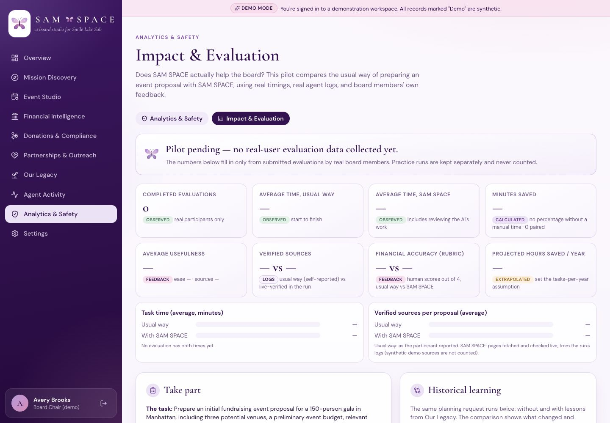
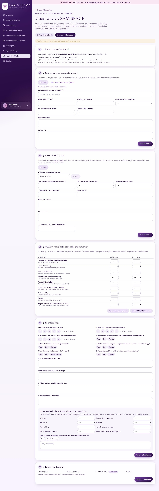
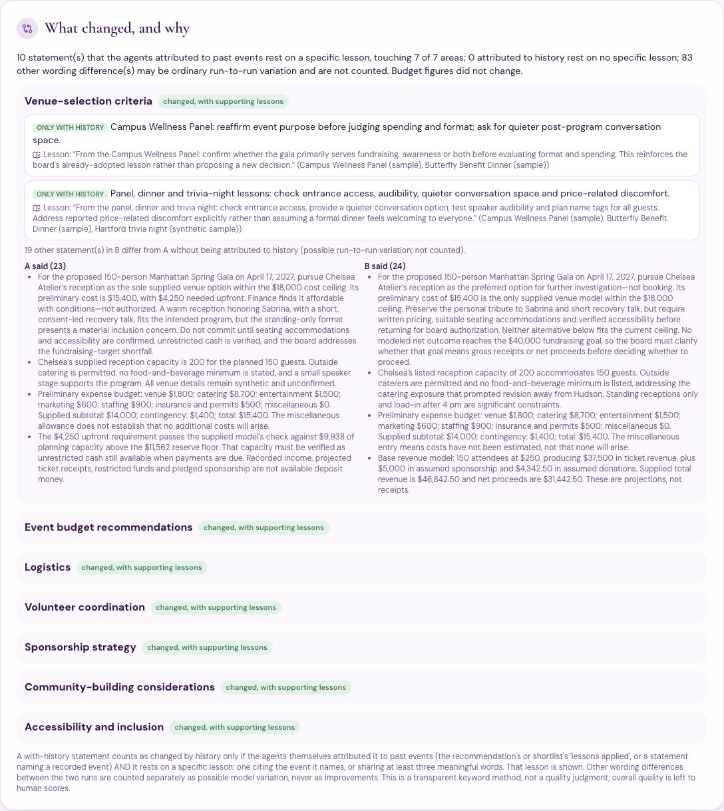

# Impact & Evaluation: does SAM SPACE help the board?

This phase adds a way to *measure* SAM SPACE against the board's usual way of working, instead of asserting that it helps. It lives in **Analytics & Safety → Impact & Evaluation**.

> **Status: formal pilot pending.** No board member has completed this timed evaluation yet, so the dashboard and the exported summary say *“Pilot pending — no real-user evaluation data collected yet.”* No time savings or ratings are claimed. Separately, three board members tried SAM SPACE informally and gave feedback (see [evidence/README.md](evidence/README.md) §9).
>
> What *is* measured and reported:
> - the Our Legacy pre-check (live, real models)
> - three historical-learning comparisons (live, real models)
> - the automated tests

## 0. Pre-check: Our Legacy works end to end (live, real models)

Before building the evaluation, the import features were re-tested through the **real UI with real OpenAI models**. The test used a throwaway database so the demo data wasn't duplicated, with the synthetic sample files in `samples/legacy/`. Result: **12/12 checks passed** ([`evidence/impact/legacy_verification_live.json`](evidence/impact/legacy_verification_live.json)).

| Check | Observed |
|---|---|
| Upload PDF, CSV, XLSX, photo, and notes for one event | All 5 stored; photo kept but not read |
| Real-model extraction | Completed ($0.00095, gpt-6-luna) |
| Figures quoted from the source | $11,850 raised “We raised $11,850”; $3,400 expenses; $10,000 goal |
| Conflicting figures | Attendance 120 vs 118 left for the board |
| Prompt injection in the notes | Screened (1 flag); the photo was never a source |
| Review and correct before saving | Edited title saved as *board edited*; chosen attendance as *board's choice* |
| Save and retrieve | Event listed, 5 documents and 1 photo attached, status *document extracted* |
| Conversational entry | 60 guests, year 2024; no title invented (listed as missing) |
| Board reflection | Saved with author, time, and original words |
| Evidence-linked lessons | Run #3 (throwaway database): 9 lessons, every one citing existing records ($0.048) |

The remaining check is whether historical lessons reach the Fundraising & Events agent. §4 covers it: every with-history run's handoff log records the events and lessons passed, under `history_passed`.

## 1. The task and the evaluation

**Fixed task:** *Prepare an initial fundraising event proposal for a 150-person gala in Manhattan, including three potential venues, a preliminary event budget, relevant lessons from past foundation events, and one draft venue inquiry email.* It has eight deliverables, listed in [`evidence/impact/test_instructions.md`](evidence/impact/test_instructions.md).

One participant works through six short steps and can save and come back:

1. **About this evaluation**
   - Reports show a code (P1, P2…).
   - A name appears only if the participant ticks both *show my name* and *permission to quote me*.
2. **Usual way (manual baseline)**
   - Start/Finish buttons record the time on the server clock. Times can also be typed in.
   - It records tools, venues found, sources checked, whether a financial model, past-event lessons, and an outreach draft were done, difficulties, and comments.
   - If there was no manual comparison, the participant marks it **unavailable**, and it is never filled in.
3. **With SAM SPACE**
   - Start/Finish again; reading and correcting the AI's work counts toward the time.
   - The participant links the Event Studio run. Its own logs then supply the agents involved, venues, live-verified versus synthetic sources, financial completeness, whether every figure traces to a calculation, past events consulted, lessons applied, unsent drafts, and the **agents' own time and cost**. These are kept separate from the participant's time.
   - The participant adds: whether the calculations were correct, whether the draft was usable, errors, unsupported claims, and minutes spent reviewing.
4. **Quality rubric:** both proposals are scored 0–4 on 9 dimensions by a person, using the same rubric ([`rubric.md`](evidence/impact/rubric.md)). **No AI model scores anything.**
5. **Feedback:**
   - your 12 questions: three 1–5 ratings, five multiple-choice, four open questions
   - a mission section: kindness, connection, belonging, inclusion, accessibility, mental-health awareness, eating-disorder research, and meaningful participation, plus *“Does SAM SPACE help preserve and advance the mission?”*

   Answers are stored exactly as written. Butterflies appear only after a successful save.
6. **Review and submit:** shows minutes saved and the percentage. A negative number means SAM SPACE took longer, and it is shown as such.

**Practice runs** (*not counted*) let someone try the form. They are flagged and reported separately, and the automated tests prove they never reach the results.

## 2. Calculations (deterministic Python, `services/impact_eval.py`)

| Measure | Formula | Label |
|---|---|---|
| Minutes saved | manual minutes − SAM SPACE minutes (negative allowed) | Calculated |
| Percentage time reduction | minutes saved ÷ manual minutes × 100, only if manual minutes > 0 | Calculated |
| Projected annual hours saved | measured minutes saved × tasks per year (set by the chair) ÷ 60 | Extrapolated, assumption |
| Averages | submitted, real evaluations only; minutes saved uses evaluations that have both times | Observed |

With fewer than five participants, the dashboard says *“Small pilot (n=…): not statistically representative.”*

## 3. Impact dashboard

The dashboard shows the following, each labeled *observed, calculated, extrapolated, from feedback,* or *from the run's logs*:
- completed evaluations
- average time each way
- minutes saved and the percentage
- average usefulness
- verified sources: usual way (self-reported) versus live-verified in the run
- financial accuracy: human rubric scores
- projected annual hours
- every participant's answers and comments as written

Practice records sit in their own card. The export ([`impact_summary.md`](evidence/impact/impact_summary.md), [`impact_evidence.json`](evidence/impact/impact_evidence.json)) is anonymized and lists what is missing.

## 4. Historical learning: does Our Legacy change recommendations? (live, real models)

The same planning request runs twice through the production pipeline: **A** skips the Event Intelligence step, **B** includes it. Same plan, data, and strategy. For seven areas, code compares what each run said:
- venue selection
- budget
- logistics
- volunteers
- sponsorship
- community building
- accessibility and inclusion

**Method, deliberately conservative:** a with-history statement counts as *changed by history* only if both of these hold:
- **The agents attributed it to past events:** it appears in “lessons applied”, or it names a recorded event.
- **It rests on a specific lesson:** one citing the event it names, or sharing at least three meaningful words. That lesson is shown next to it.

Everything else that differs is counted as possible run-to-run variation and is never claimed as an improvement. Overall quality is left to a person's rubric scores, and B is not assumed to be better.

**Why this rule:** my first version matched on any two shared words. On the live run it claimed 88 changes, many resting on words like “spring” or “guests”. I tightened it before reporting anything. The stricter rule finds 10 for the same run.

| Comparison | Request | Runs (A / B) | Cost A / B | History-attributed changes resting on a lesson | Areas | Budget figures | Other differences (not counted) |
|---|---|---|---|---|---|---|---|
| **#3 (this phase)** | 150-person Manhattan gala: venues, budget, lessons, inquiry draft | #38 / #39 | $0.2366 / $0.3351 | **10** | 7 of 7 | unchanged ($15,400, 10%) | 83 |
| #2 (Prompt 8) | 120-guest raffle | #36 / #37 | $0.1944 / $0.3062 | 14 | 6 of 7 | unchanged | 84 |
| #1 (Prompt 3) | 150-person gala | #6 / #7 | $0.1375 / $0.2115 | 3 | 4 of 7 | **changed**: contingency 10% → 22%, total $14,850 → $16,470 | 83 |

**Examples from #3:** in every area, B carries specific recorded lessons that A doesn't.

| What B added | Source (synthetic sample records) |
|---|---|
| Brief volunteers and assign station leads; keep a staffed welcome point | Butterfly Spring Raffle reflections |
| Check entrance access, audibility, and a quieter conversation space | Campus Wellness Panel, Benefit Dinner, and Hartford trivia night |
| Require written catering terms and guest-count rules; plan volunteer meals separately | Panel, Walk, and Dinner food-cost lessons |
| Set sponsor-artwork deadlines a month before printing | Spring Awareness Walk |

**What history did not change in #3:** the venue (Chelsea Atelier), the projected total, and the contingency.

**Honest reading:**
- Our Legacy reliably changes the operational content of a plan: volunteers, access, catering terms, sponsorship timing. Each change traces to a named record.
- It changed the budget once (#1), when reflections reported overruns.
- Whether those changes make the proposals better is for the human scores, which are **not yet entered**.
- All past events used are synthetic demonstration records.

Inputs, models, traces, outputs, token use, and costs are preserved in `evidence/impact/`:
- `history_comparison_3_gala.json`
- `history_comparison_3_report.md`
- `trace_run_38.json`, `trace_run_39.json`
- `packet_run_38.md`, `packet_run_39.md`

## 5. What is missing

- **Formal timed evaluations: none yet** (three board members tried the app informally; see [evidence/README.md](evidence/README.md) §9). To run the pilot, a board member opens *Impact & Evaluation → Start my evaluation* and follows the six steps (about as long as the task itself). Then run `python -m backend.scripts.export_impact_evidence` to refresh the evidence.
- **Human quality scores** for the history comparisons: none entered.
- **The tasks-per-year assumption:** not set, so there is no projection.

## 6. Limits

- At most a handful of participants: a small pilot, not a statistical study.
- The participant knows which condition is which (no blinding).
- Manual counts are self-reported.
- Model outputs vary between runs, which is why most differences are not counted.
- The keyword attribution method is transparent but blunt. It can miss a lesson phrased differently, and it can't judge quality.

## 7. Tests (`tests/test_impact.py`, 19 passing)

**Your 18 required behaviors:**
1. creating a record
2. start and finish on the server clock
3. manual times typed by hand, including finish-before-start rejection and review time no longer than the attempt
4. SAM SPACE time
5. minutes saved
6. percentage
7. zero-minute baseline
8. negative savings
9. annual projection
10. feedback validation
11. feedback stored exactly, including negative answers
12. history comparison records, including the rule that an unsupported statement is never called an improvement
13. linking to a real run, with metrics from its logs
14. practice records never counted, and *Pilot pending* shown
15. authorization, privacy, and named attribution only with both choices
16. missing data reported, not filled in
17. anonymized export that states missing data and includes unfavorable feedback
18. dashboard totals recomputed from the stored rows

The fixtures live only in the test database and are never counted as users.
