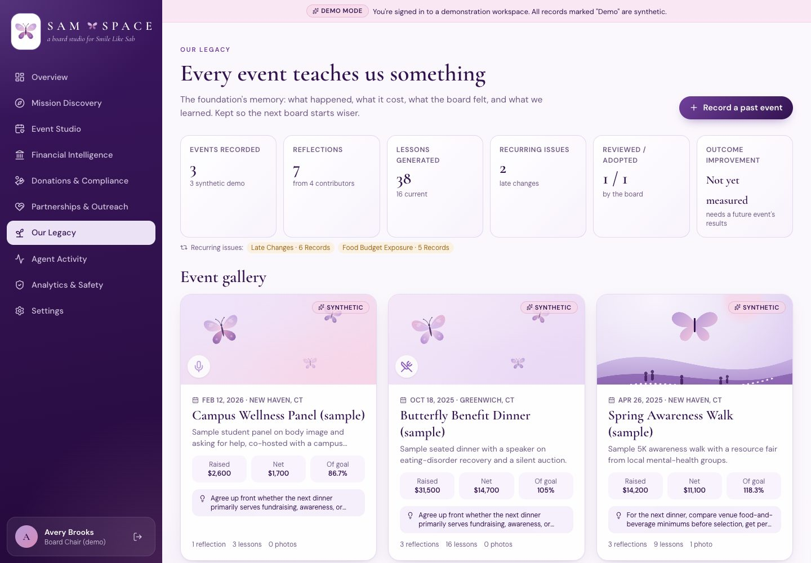
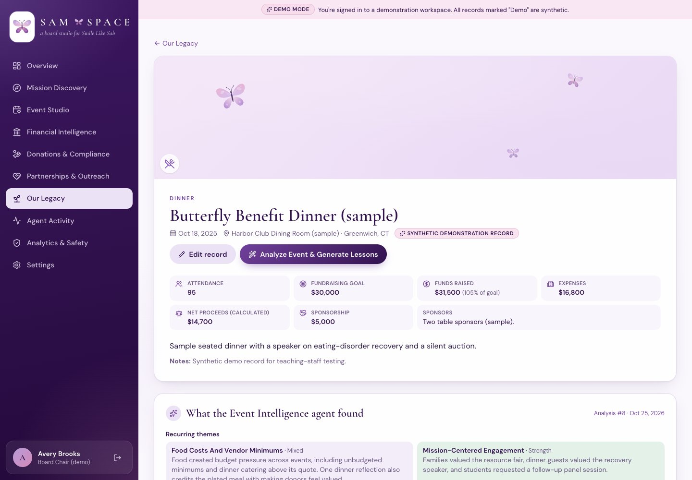
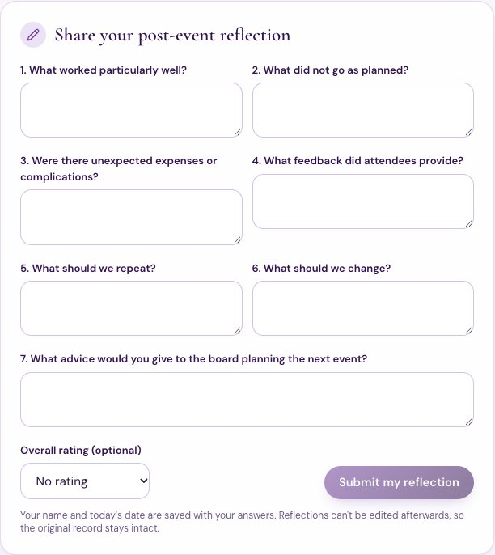
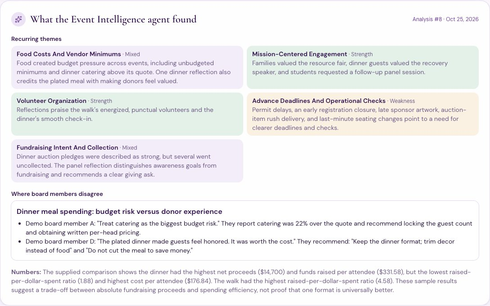
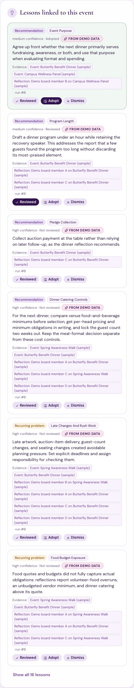
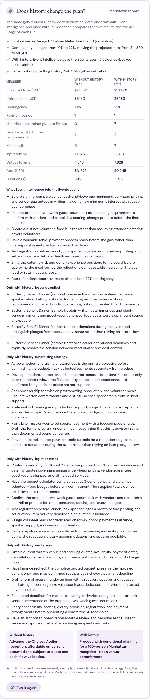

# Our Legacy + Event Intelligence: example workflow

Our Legacy preserves the foundation's event history so future board members can learn from earlier fundraisers. It also feeds that history into planning through the Event Intelligence & Learning agent.

> **Data honesty.**
> - Every past event in the demo workspace is synthetic. Each is labeled *(sample)* and *Synthetic*, and none is a real Sabrina Audrey Milone Foundation event or result.
> - Covers without photos are generated decorative illustrations. The one uploaded image is captioned *"Synthetic illustration (not an event photograph)"*.
> - All figures below come from real runs against the OpenAI API. They are stored in the app's `model_usage` table and shown in Agent Activity.

## 1. The gallery and impact metrics

**Impact metrics.** Each is computed in `backend/app/services/legacy.py`:

| Metric | Definition |
|---|---|
| Events recorded | Rows in `historical_events` (synthetic demo rows counted separately) |
| Reflections | Board reflections, and how many distinct people contributed them |
| Lessons generated | Every lesson ever produced, plus how many are current (not superseded) |
| Recurring issues | Themes of current "recurring problem" lessons whose evidence spans **2 or more** separate records. Near-duplicate theme names are merged. |
| Reviewed / adopted | Lessons a board member marked *Reviewed* or *Adopted* |
| Outcome improvement | Always **"Not yet measured"**. Measuring it needs the results of a future event planned with these lessons, so SAM SPACE claims no improvement. |

**Gallery cards** show:
- date, location, and description
- the recorded outcome: funds raised, **net (calculated in code)**, and percent of goal
- the newest linked lesson
- counts of reflections, lessons, and photos

## 2. An event record

**Fields.** Board members with *manage events* permission can create and edit:
- name, date, type, venue, and location
- attendance, fundraising goal, funds raised, and expenses
- sponsorship amount and sponsors
- summary and notes
- photos

Net proceeds and percent of goal are calculated, never typed in.

**Edits.** Every edit is written to the audit log with before and after values. Events cannot be deleted, because this is institutional memory.

**Photos.** The server checks each upload's actual file contents and accepts only PNG, JPEG, or WebP up to 5 MB. Photos are stored outside the web root, and only signed-in members of the same workspace can view them.

## 3. Board-member reflections (append-only)

**The seven questions:**
1. What worked particularly well?
2. What did not go as planned?
3. Were there unexpected expenses or complications?
4. What feedback did attendees provide?
5. What should we repeat?
6. What should we change?
7. What advice would you give to the board planning the next event?

**Rules:**
- Many board members can reflect on the same event.
- Each reflection keeps the **contributor's name, user ID, and submission date**.
- There is **no edit or delete route**. Tests confirm that update and delete requests fail, and that an AI analysis leaves every reflection byte-for-byte unchanged.
- AI output is stored separately, as lessons.

**Synthetic feedback that disagrees.** The demo history includes three past events and seven reflections that contradict each other on purpose:
- **Food costs are a problem:**
  - Member A (dinner): "catering 22% over the quote"
  - Member C (walk): "an $800 food-truck minimum"
  - Member A (walk): "volunteer food vouchers $600 over"
- **The meal was worth it:** Member D (dinner): "Do not cut the meal to save money."

## 4. "Analyze Event & Generate Lessons"

On the *Butterfly Benefit Dinner (sample)* page, the button starts an `event_learning` workflow focused on that event.

**What the agent does:**
- Reads all authorized event and reflection records.
- Compares outcomes **in code**, and only when at least two events have both funds raised and expenses.
- Asks gpt-6.1-sol (routed for medium complexity plus reasoning) for:
  - recurring themes (strength, weakness, or mixed)
  - lessons
  - disagreements
  - evidence-backed planning constraints

**What code then checks:**
- Every cited event and reflection ID must exist. Lessons with no valid evidence are dropped, and the run shows a warning.
- Disagreements are shown with every position in the member's own words. They are never resolved or hidden.
- Lessons are saved with their **theme, evidence, and scope**. A newer analysis of the same event supersedes older *unreviewed* lessons, but never ones the board reviewed or adopted.

Each lesson card links to the exact event and reflections behind it. The board can mark it *Reviewed*, *Adopt* it, or *Dismiss* it.

**Measured runs:**

| Run | What | Model calls (models) | Tokens in (cached) / out | Cost | Time |
|---|---|---|---|---|---|
| #5 | Analyze the benefit dinner | 2 (gpt-6.1-sol, gpt-6-luna) | 5,007 (0) / 3,267 | $0.0319 | 43 s |
| #8 | Same analysis, from the button | 2 (gpt-6.1-sol, gpt-6-luna) | 4,838 (**2,867**) / 2,733 | $0.0215 | 36 s |

Run #8 shows OpenAI's automatic prompt caching at work. 2,867 repeated input tokens were billed at the cached rate, one-twentieth of the normal input price ($0.10 vs $2.00 per million tokens for gpt-6.1-sol). That, together with a shorter answer (2,733 vs 3,267 output tokens), made the run 33% cheaper.

## 5. Planning integration: history advises, it never overrides

When the board asks the agents to plan a fundraiser:

1. The **Orchestrator** first asks **Event Intelligence** for lessons relevant to the new event.
2. Event Intelligence returns evidence-backed constraints to the **Events agent**, for example "compare venue food-and-beverage minimums before choosing a venue."
3. The venue fixtures include real-world catering terms (food-and-beverage minimums), which the budget calculator applies in code, so the lesson can actually change the plan.

**Guarantees, enforced in code and tested:**
- History constraints are namespaced `history:*`. The Events agent reads hard spending limits **only** from Financial Analysis (`source_agent == financial_analysis`), so a lesson cannot pose as a budget limit.
- Finance always computes from the ledger and the board's own limit. A test feeds Event Intelligence a "history says spend up to $80,000" constraint and confirms that the $18,000 board limit still governs.
- The Events agent's instructions say lessons shape ranking and strategy, but never override computed costs, Finance's limits, or verified sources.

## 6. Evidence test: the same plan without and with history

The **"Does history change the plan?"** card runs the same request twice: *"Plan a 150-person Manhattan fundraising gala and check whether we can afford it."* Both runs use the same event plan, synthetic venue data, and Auto model strategy. Run A skips Event Intelligence and run B consults it. Code then compares the stored results.

**Experiment #1** compared runs #6 and #7. The full write-up is in [`evidence/history_ab_experiment_1.md`](evidence/history_ab_experiment_1.md), and the raw data in `evidence/history_ab_experiment_1.json`.

| Measure | Without history (#6) | With history (#7) |
|---|---|---|
| Final venue | Chelsea Atelier (synthetic), reception | Chelsea Atelier (synthetic), reception |
| Contingency | 10% (default) | **22%** (from the reported catering overrun) |
| Projected total | $14,850 | **$16,470** |
| Historical constraints given to Events | 0 | **7** |
| Lessons applied in the recommendation | 1 (says none were supplied) | **4** |
| Model calls | 6 | 7 |
| Tokens in / out | 10,326 / 4,848 | 16,718 / 7,828 |
| Cost | $0.1375 | $0.2115 (+$0.0740) |
| Time | 90 s | 134 s |

**What changed because of history:**
- **Catering minimums.** Only the with-history plan told the Events agent to *"compare venue food-and-beverage minimums, per-head pricing, and vendor guarantees in writing."* This is the lesson the board's reflections pointed to.
- **New logistics and strategy items:**
  - a separate volunteer-food budget
  - a tested table-side payment process, because dinner pledges went uncollected
  - a two-week guest-count lock
  - earlier sponsor-logo and registration deadlines
- **A more honest recommendation.** It surfaces the board's unresolved disagreement: *"Some sample board reflections treat the plated meal as essential to donor experience; the reception format should not be presented as a consensus choice."*
- **A higher contingency.** It raised the projected cost by $1,620, which still fits the $18,000 limit. History made the plan more cautious without overriding Finance.

**Cost of the history step:** one extra gpt-6.1-sol call, $0.074 (54% more than without history), and 44 seconds.

**Caveat.** This is one run of each condition. Model outputs vary, so some text differences are wording, not substance. The numeric changes (contingency, totals, constraint counts) come from code and repeat.

## 7. Tests

The Legacy tests are in `tests/test_legacy.py` (the suite totals 132 tests). They run offline with a scripted model.

**Records and reflections:**
- create/edit with every field, calculated net, an audited before/after diff, and no delete
- multi-member reflections with identity and date; append-only, with AI never modifying them

**Photos:** file-signature validation, size limit, private serving, removal

**Event Intelligence:**
- analysis produces themes, disagreements, and lessons linked to evidence
- the latest analysis persists on the event page
- re-analysis supersedes unreviewed lessons and keeps adopted ones

**Metrics:** recurring issues need two or more records and merge near-duplicates; no outcome-improvement claim

**Planning integration:**
- planning asks Event Intelligence first
- the without-history run skips it
- history cannot override Finance
- catering minimums are applied in code

**The A/B experiment:** runs end to end with tracked usage, produces a deterministic markdown report, and redacts results for board members without finance access

**Demo upgrade:** demo-data upgrades never touch real records
